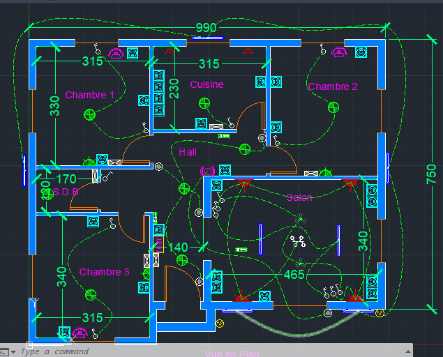
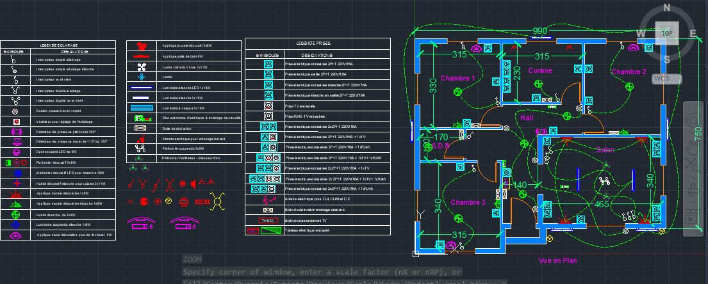
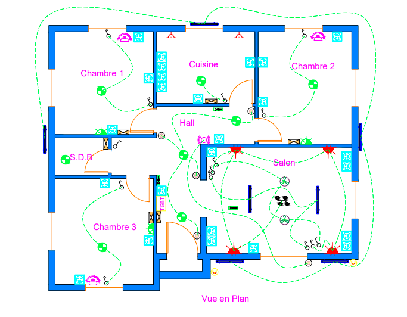

# Floor Plan with Electrical Plan

Plan de maison et son installation électrique, réalisé sous AutoCAD.

## Aperçu

### Vue AutoCAD : plan de la maison

### Vue AutoCAD : plan électrique

### Sortie PDF

## Contenu

| Fichier | Description |
|---|---|
| `dwg/Floor Plan with Electrical Plan.dwg` | Fichier source AutoCAD |
| `pdf/Floor Plan with Electrical Plan-Model.pdf` | Plan exporté en PDF |

## Contenu du plan électrique
- Implantation des prises, points lumineux et interrupteurs
- Tableau de distribution et circuits
- Légende des symboles

## Outils
- AutoCAD 2022

## Auteur
Pascal, Ingénieur d'État GEET (AIAC, Casablanca)